# SP Residency - image-generation prompts

> **Status: not generated.** The connected Higgsfield account had **0 credits** when this pack was built (27 Nov 2026), so no image was generated. Every request below is ready to run (`generation-requests.json` is the machine-readable version). Nothing on the website claims to be generated.

**30 ready** - **2 concept-only** (views the brochure never shows) - **7 blocked** (no brochure reference).

## How to run

1. Upload each reference image (`media_upload` + `media_confirm`, or your tool's image input).
2. Send the prompt with the reference(s) as **image references**, the listed model and aspect ratio.
3. Save output to the `output.raw` path, run the QA checklist against the reference, then approve.
4. Approved images: convert with `scripts/build_web_assets.py --generated` (WebP) and set `status: generated`, `approval: approved` in the manifest.

Cost quotes (Higgsfield, 27 Nov 2026): `seedream_5_5` 2.5 credits per image (4k, 16:9); `nano_banana_pro` 4 credits per image (4k, 16:9); `gpt_image_2_6` 2 credits per image (high quality, 2k, 16:9).
 Running all 30 ready requests at 4k costs roughly 92 credits.

**Recommended first step (Tier 0):** a faithful upscale of the original renders (R01, R04, R03, R18, R19, R14, R16, R17, R25, R20, R21, R22, R23, R24). It is the lowest-risk way to get web-resolution images, because the brochure interiors are only 700-1000 px wide.

### Shared photography standard (appended to every prompt)

> Natural, unfiltered professional architectural photograph. Physically accurate light and soft natural shadows; true-to-life materials with real texture (genuine wood grain, real stone veining, woven fabric weave, crisp glass reflections); balanced exposure holding detail in highlights and shadows; neutral white balance; vertical lines kept vertical; subtle real-lens character; correct furniture scale.

### Shared avoid list

- HDR look, halos or tone-mapping artefacts
- artificial glow or bloom
- oversaturated colour
- plastic, waxy or CGI-smooth surfaces
- bent, warped or melted geometry
- any added furniture, decor, plants, people, vehicles, signage, text or logos
- any change to layout, proportions, openings, counts or materials

## Phase 3 - Exterior

### EXT-01 - Main front elevation - night (enhanced)  `READY` `risk: low`

| Reference | Role |
|---|---|
| 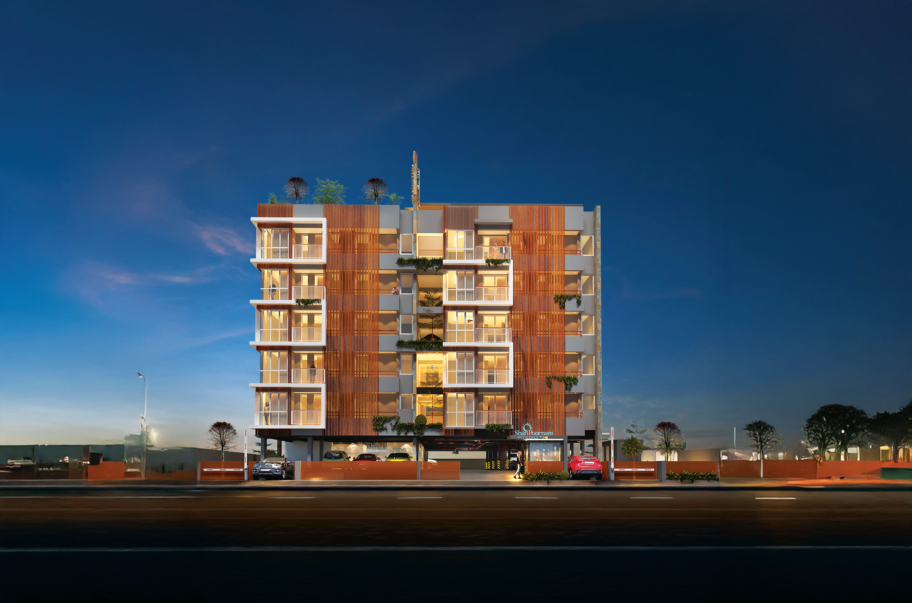 <br>`R04` `reference/elevation/p26-front-elevation-night.jpg` | geometry + composition |

**Model:** `seedream_5_5` - **Aspect:** 3:2 - **Resolution:** 4k

```text
Enhance this exact night photograph of the front (road-facing) elevation of Shan Poornam Residence, Madurai, keeping the identical frontal camera, framing and every architectural element. Blue-hour sky with the last light on the horizon; warm 2700-3000K interior light behind sheer curtains in the occupied bays; copper/teak louvres catching soft uplight; white bay frames reading clean but not glowing; teal signage over the security cabin lit at a realistic brightness; wet-free asphalt with faint reflections; street lamp at left. Natural, unfiltered professional architectural photograph. Physically accurate light and soft natural shadows; true-to-life materials with real texture (genuine wood grain, real stone veining, woven fabric weave, crisp glass reflections); balanced exposure holding detail in highlights and shadows; neutral white balance; vertical lines kept vertical; subtle real-lens character; correct furniture scale.
```

**Must preserve:** stilt level + exactly 5 residential floors + terrace (count the stacked bays); white projecting box frames around the stacked bays and their wood-tone soffits; copper/teak-tone vertical louvre fields - position, extent and colour; balcony positions, MS vertical-baluster handrails, window mullion patterns; sandstone-look pylon and the teal SP sun monogram / sign mast; cascading planters at the same ledges; rooftop trees; compound wall, gates, boom barriers, security cabin and its signage.

Output -> `generated/elevation/EXT-01.png` -> web `public/images/sp-residency/elevation/sp-front-elevation-night-enhanced.webp`

### EXT-02 - Main front elevation - daylight relight  `READY` `risk: medium`

| Reference | Role |
|---|---|
|  <br>`R04` `reference/elevation/p26-front-elevation-night.jpg` | geometry + composition (primary) |
| 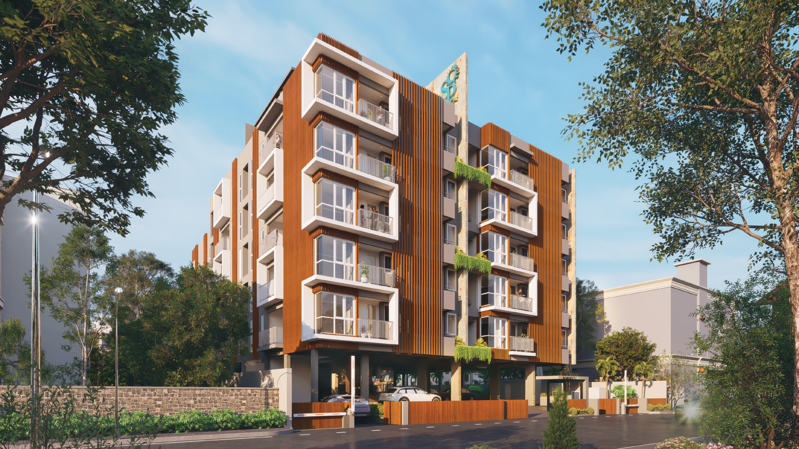 <br>`R01` `reference/exterior/p04-exterior-day-three-quarter-perspective.jpg` | daylight materials and colour |

**Model:** `nano_banana_pro` - **Aspect:** 3:2 - **Resolution:** 4k

```text
Re-light the building in the first reference image to natural late-morning daylight, using the second reference only to match daylight material colours (white frames, warm grey walls, copper/teak louvres, sandstone-look pylon). Keep the first image's frontal camera, framing, building geometry, bay count, louvre fields, planters, rooftop trees, sign mast, compound wall, gates and security cabin exactly. Clear sky with light haze, sun from the upper left, soft shadows under each bay frame and balcony slab, interiors darker than the sky as in real daylight. Natural, unfiltered professional architectural photograph. Physically accurate light and soft natural shadows; true-to-life materials with real texture (genuine wood grain, real stone veining, woven fabric weave, crisp glass reflections); balanced exposure holding detail in highlights and shadows; neutral white balance; vertical lines kept vertical; subtle real-lens character; correct furniture scale.
```

**Must preserve:** stilt level + exactly 5 residential floors + terrace (count the stacked bays); white projecting box frames around the stacked bays and their wood-tone soffits; copper/teak-tone vertical louvre fields - position, extent and colour; balcony positions, MS vertical-baluster handrails, window mullion patterns; sandstone-look pylon and the teal SP sun monogram / sign mast; cascading planters at the same ledges; rooftop trees; compound wall, gates, boom barriers, security cabin and its signage.

**Note:** Lighting change only. Reject if any floor, bay or louvre field differs from R04.

Output -> `generated/elevation/EXT-02.png` -> web `public/images/sp-residency/elevation/sp-front-elevation-day.webp`

### EXT-03 - Three-quarter perspective - day (enhanced)  `READY` `risk: low`

| Reference | Role |
|---|---|
|  <br>`R01` `reference/exterior/p04-exterior-day-three-quarter-perspective.jpg` | geometry + composition |

**Model:** `seedream_5_5` - **Aspect:** 16:9 - **Resolution:** 4k

```text
Enhance this exact daylight three-quarter photograph of Shan Poornam Residence, keeping the same low street-level camera, framing and all architecture. Late-morning sun from the left, soft blue sky with light cloud; crisp shadow lines under every white bay frame and balcony slab; louvres keep their exact copper/teak colour with a matte finish; clear glazing reflecting sky and trees with visible interior depth; real leaves on the framing trees; stone texture on the rubble compound wall. Natural, unfiltered professional architectural photograph. Physically accurate light and soft natural shadows; true-to-life materials with real texture (genuine wood grain, real stone veining, woven fabric weave, crisp glass reflections); balanced exposure holding detail in highlights and shadows; neutral white balance; vertical lines kept vertical; subtle real-lens character; correct furniture scale.
```

**Must preserve:** stilt level + exactly 5 residential floors + terrace (count the stacked bays); white projecting box frames around the stacked bays and their wood-tone soffits; copper/teak-tone vertical louvre fields - position, extent and colour; balcony positions, MS vertical-baluster handrails, window mullion patterns; sandstone-look pylon and the teal SP sun monogram / sign mast; cascading planters at the same ledges; rooftop trees; compound wall, gates, boom barriers, security cabin and its signage.

Output -> `generated/exterior/EXT-03.png` -> web `public/images/sp-residency/exterior/sp-exterior-day-3q-enhanced.webp`

### EXT-04 - Three-quarter perspective - dusk  `READY` `risk: medium`

| Reference | Role |
|---|---|
|  <br>`R01` `reference/exterior/p04-exterior-day-three-quarter-perspective.jpg` | geometry + composition (primary) |
| 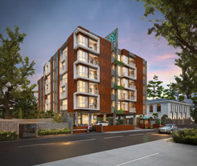 <br>`R02` `reference/exterior/p28-exterior-dusk-three-quarter-thumbnail.jpg` | dusk lighting only |

**Model:** `nano_banana_pro` - **Aspect:** 16:9 - **Resolution:** 4k

```text
Re-light the building in the first reference image to dusk, matching the time of day, sky colour and warm window glow of the second (small) reference. Keep the first image's camera, framing, building geometry, bay count, louvres, pylon with SP monogram, planters, trees and compound wall exactly. Soft violet-to-peach sky, warm interior light in some bays, gentle facade uplight. Natural, unfiltered professional architectural photograph. Physically accurate light and soft natural shadows; true-to-life materials with real texture (genuine wood grain, real stone veining, woven fabric weave, crisp glass reflections); balanced exposure holding detail in highlights and shadows; neutral white balance; vertical lines kept vertical; subtle real-lens character; correct furniture scale.
```

**Must preserve:** stilt level + exactly 5 residential floors + terrace (count the stacked bays); white projecting box frames around the stacked bays and their wood-tone soffits; copper/teak-tone vertical louvre fields - position, extent and colour; balcony positions, MS vertical-baluster handrails, window mullion patterns; sandstone-look pylon and the teal SP sun monogram / sign mast; cascading planters at the same ledges; rooftop trees; compound wall, gates, boom barriers, security cabin and its signage.

**Note:** R02 is 245 px - lighting reference only, never geometry.

Output -> `generated/exterior/EXT-04.png` -> web `public/images/sp-residency/exterior/sp-exterior-dusk-3q.webp`

### EXT-05 - Side elevation  `BLOCKED` `risk: blocked`

**Note:** BLOCKED. The brochure contains no side or rear elevation. R01 shows one side obliquely only; an orthographic side elevation would require inventing it. Needs the architect's elevation drawing.

### EXT-06 - Building entrance - security cabin (enhanced)  `READY` `risk: low`

| Reference | Role |
|---|---|
| 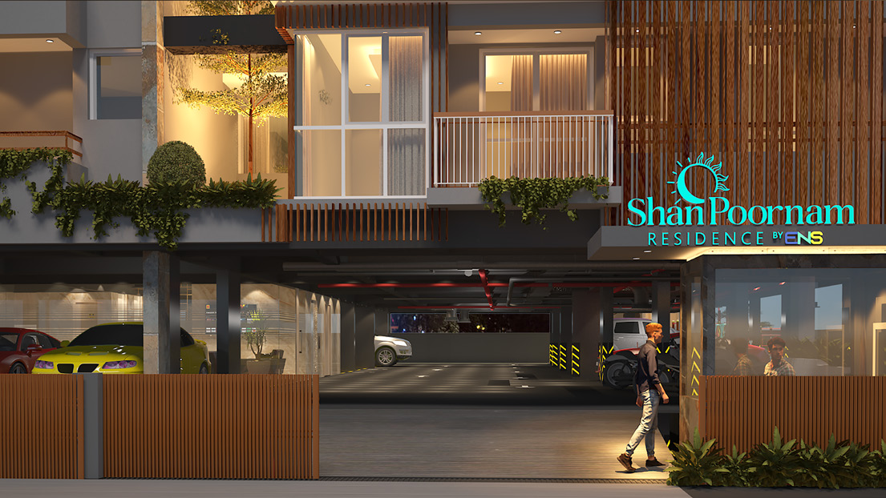 <br>`R03` `reference/exterior/p11-entrance-security-cabin-night.jpg` | geometry + composition |

**Model:** `seedream_5_5` - **Aspect:** 16:9 - **Resolution:** 4k

```text
Enhance this exact night photograph of the residence entrance: glazed security cabin with the illuminated teal 'Shan Poornam Residence by ENS' lettering, timber-slat base, stilt parking beyond with black-and-yellow hazard-striped columns and red sprinkler mains under a dark soffit, white bay frames and louvres above. Keep camera, framing and the existing person and car unchanged in position. Realistic signage brightness, warm cabin interior light, cool ambient night, real tyre and paint reflections, concrete paving texture. Natural, unfiltered professional architectural photograph. Physically accurate light and soft natural shadows; true-to-life materials with real texture (genuine wood grain, real stone veining, woven fabric weave, crisp glass reflections); balanced exposure holding detail in highlights and shadows; neutral white balance; vertical lines kept vertical; subtle real-lens character; correct furniture scale.
```

**Must preserve:** cabin size, glazing and signage text/position; column positions and hazard striping; sprinkler mains; facade elements above.

Output -> `generated/entrance/EXT-06.png` -> web `public/images/sp-residency/entrance/sp-entrance-security-cabin-enhanced.webp`

### EXT-07 - Entrance frontage - dusk (enhanced crop)  `READY` `risk: low`

| Reference | Role |
|---|---|
| 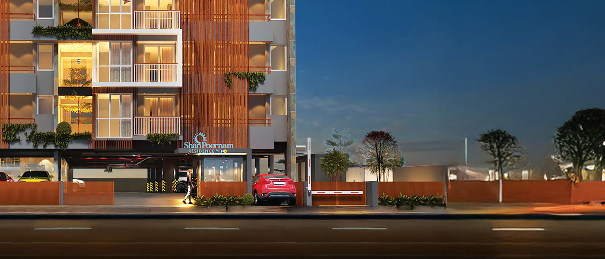 <br>`R34` `reference/elevation/p26-entrance-frontage-crop.jpg` | geometry + composition |
|  <br>`R04` `reference/elevation/p26-front-elevation-night.jpg` | context for the uncropped building |

**Model:** `seedream_5_5` - **Aspect:** 21:9 - **Resolution:** 4k

```text
Enhance this exact street-level frontage of Shan Poornam Residence at blue hour: illuminated security cabin with teal signage, timber-look compound wall, boom barrier, stilt parking entry with hazard-striped columns, the lowest residential floors with white bay frames, copper louvres and trailing planters. Keep framing and all elements; realistic light falloff on the pavement, warm interior glow, natural sky gradient. Natural, unfiltered professional architectural photograph. Physically accurate light and soft natural shadows; true-to-life materials with real texture (genuine wood grain, real stone veining, woven fabric weave, crisp glass reflections); balanced exposure holding detail in highlights and shadows; neutral white balance; vertical lines kept vertical; subtle real-lens character; correct furniture scale.
```

**Must preserve:** cabin, signage, boom barrier and wall positions; column count in view; facade above.

Output -> `generated/entrance/EXT-07.png` -> web `public/images/sp-residency/entrance/sp-entrance-frontage-dusk.webp`

### EXT-08 - Apartment lobby (enhanced)  `READY` `risk: low`

| Reference | Role |
|---|---|
| 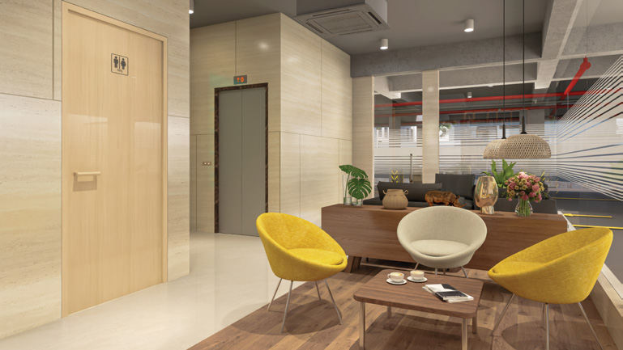 <br>`R18` `reference/amenities/p11-private-lobby.jpg` | geometry + composition |

**Model:** `seedream_5_5` - **Aspect:** 16:9 - **Resolution:** 4k

```text
Enhance this exact photograph of the private lobby: travertine-look wall panels, grey lift door, timber restroom door, mustard and ivory bucket chairs on wire legs, walnut coffee table and console, woven rattan pendant, horizontal-stripe frosted glass partition, exposed soffit with red sprinkler mains, walnut floor meeting polished white tiles. Same camera and layout. Soft daylight from the glazing mixed with warm pendant light; real travertine pores and veining; visible upholstery weave; believable reflections in the polished tile. Natural, unfiltered professional architectural photograph. Physically accurate light and soft natural shadows; true-to-life materials with real texture (genuine wood grain, real stone veining, woven fabric weave, crisp glass reflections); balanced exposure holding detail in highlights and shadows; neutral white balance; vertical lines kept vertical; subtle real-lens character; correct furniture scale.
```

**Must preserve:** every furniture piece and its position; lift and restroom doors; pendant; striped glass; exposed services.

Output -> `generated/lobby/EXT-08.png` -> web `public/images/sp-residency/lobby/sp-lobby-enhanced.webp`

### EXT-09 - Lobby lounge / library (enhanced)  `READY` `risk: low`

| Reference | Role |
|---|---|
| 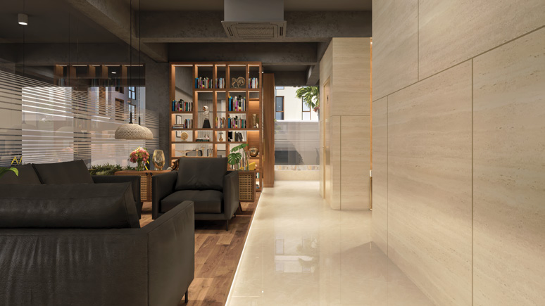 <br>`R19` `reference/amenities/p25-lobby-library-lounge.jpg` | geometry + composition |

**Model:** `seedream_5_5` - **Aspect:** 16:9 - **Resolution:** 4k

```text
Enhance this exact photograph of the lobby lounge and library: charcoal leather sofas and armchair, walnut floor with a slim LED edge stepping down to a polished white tile walkway, backlit walnut and black-metal bookshelf, rattan-detailed side cabinets, woven pendant, striped frosted glazing, tall travertine-look panels with shadow gaps, exposed grey soffit with cassette AC. Same camera and layout. Soft daylight, warm shelf lighting, natural leather creasing, real stone texture. Natural, unfiltered professional architectural photograph. Physically accurate light and soft natural shadows; true-to-life materials with real texture (genuine wood grain, real stone veining, woven fabric weave, crisp glass reflections); balanced exposure holding detail in highlights and shadows; neutral white balance; vertical lines kept vertical; subtle real-lens character; correct furniture scale.
```

**Must preserve:** sofa/armchair positions; bookshelf grid and contents layout; floor transition; panel joints; ceiling services.

**Note:** R19 is uncaptioned in the brochure (assumption A2).

Output -> `generated/lobby/EXT-09.png` -> web `public/images/sp-residency/lobby/sp-lobby-library-lounge-enhanced.webp`

### EXT-10 - Parking & access - stilt cut-away (enhanced)  `READY` `risk: low`

| Reference | Role |
|---|---|
| 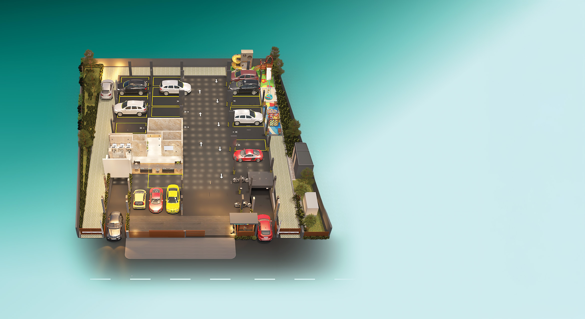 <br>`R05` `reference/floor-plans/p10-stilt-floor-plan-3d.jpg` | geometry + composition |

**Model:** `seedream_5_5` - **Aspect:** 16:9 - **Resolution:** 4k

```text
Enhance this exact 3D cut-away of the stilt floor as a photoreal architectural model photograph: same high oblique camera, same parking layout with yellow bay lines, two-way drive aisle with arrows, lobby block with lobby, management office, co-working and library, playground in the far corner, perimeter garden strips, security cabin and utilities, compound wall and gates. Soft overhead daylight, realistic asphalt, paving, foliage and car paint; keep the teal gradient backdrop. Natural, unfiltered professional architectural photograph. Physically accurate light and soft natural shadows; true-to-life materials with real texture (genuine wood grain, real stone veining, woven fabric weave, crisp glass reflections); balanced exposure holding detail in highlights and shadows; neutral white balance; vertical lines kept vertical; subtle real-lens character; correct furniture scale.
```

**Must preserve:** all bay positions and markings; lobby block plan; playground equipment layout; entry/exit openings and cabin; number and position of drawn cars.

Output -> `generated/amenities/EXT-10.png` -> web `public/images/sp-residency/amenities/sp-stilt-plan-3d-enhanced.webp`

### EXT-11 - Parking & access - eye-level stilt drive (NEW VIEW)  `CONCEPT ONLY` `risk: high`

| Reference | Role |
|---|---|
|  <br>`R03` `reference/exterior/p11-entrance-security-cabin-night.jpg` | stilt materials: soffit, columns, striping |
|  <br>`R05` `reference/floor-plans/p10-stilt-floor-plan-3d.jpg` | stilt layout |

**Model:** `nano_banana_pro` - **Aspect:** 16:9 - **Resolution:** 4k

```text
Eye-level photograph standing just inside the south-east vehicle entrance of the stilt parking of the building in the references, looking north along the two-way central drive aisle. Use only what the references show: dark soffit with red sprinkler mains, columns with black-and-yellow hazard bands, yellow-lined bays either side, direction arrows on the asphalt, the glazed lobby block on the left. Soft daylight from the open perimeter. Natural, unfiltered professional architectural photograph. Physically accurate light and soft natural shadows; true-to-life materials with real texture (genuine wood grain, real stone veining, woven fabric weave, crisp glass reflections); balanced exposure holding detail in highlights and shadows; neutral white balance; vertical lines kept vertical; subtle real-lens character; correct furniture scale.
```

**Must preserve:** aisle direction and width relative to bays; lobby block on the west side.

**Note:** CONCEPT ONLY - not for publication without client approval. The brochure never shows this view; column grid, ceiling height and lobby facade will be inferred by the model.

Output -> `generated/entrance/EXT-11.png` (not for web)

### EXT-12 - Terrace & amenities - terrace cut-away (enhanced)  `READY` `risk: low`

| Reference | Role |
|---|---|
| 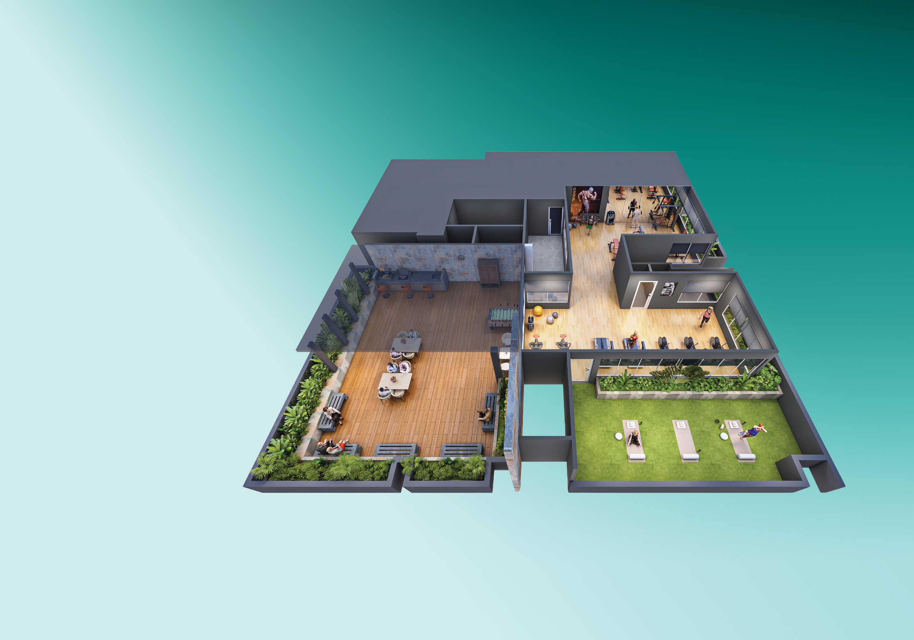 <br>`R06` `reference/floor-plans/p13-terrace-floor-plan-3d.jpg` | geometry + composition |

**Model:** `seedream_5_5` - **Aspect:** 4:3 - **Resolution:** 4k

```text
Enhance this exact 3D cut-away of the terrace level as a photoreal architectural model photograph: same camera; timber-deck rooftop lounge with dining tables, outdoor lounge benches, BBQ counter against a stone-tile wall, foosball games corner, glazed gym with equipment and mural, outdoor yoga lawn with three loungers, perimeter terrace-garden planting, open light-well. Soft late-afternoon light, real timber grain, real turf, real foliage; keep the teal gradient backdrop. Natural, unfiltered professional architectural photograph. Physically accurate light and soft natural shadows; true-to-life materials with real texture (genuine wood grain, real stone veining, woven fabric weave, crisp glass reflections); balanced exposure holding detail in highlights and shadows; neutral white balance; vertical lines kept vertical; subtle real-lens character; correct furniture scale.
```

**Must preserve:** every zone boundary and its numbered position (10-16); furniture counts; light-well.

Output -> `generated/amenities/EXT-12.png` -> web `public/images/sp-residency/amenities/sp-terrace-plan-3d-enhanced.webp`

### EXT-13 - Aerial perspective - high oblique (NEW VIEW)  `CONCEPT ONLY` `risk: high`

| Reference | Role |
|---|---|
|  <br>`R01` `reference/exterior/p04-exterior-day-three-quarter-perspective.jpg` | front + side facades (primary) |
|  <br>`R04` `reference/elevation/p26-front-elevation-night.jpg` | front facade + rooftop |
|  <br>`R06` `reference/floor-plans/p13-terrace-floor-plan-3d.jpg` | terrace layout |

**Model:** `nano_banana_pro` - **Aspect:** 16:9 - **Resolution:** 4k

```text
High oblique aerial photograph from the same side as the first reference, roughly 30 degrees down, showing the front facade, the same side facade, and the terrace level of Shan Poornam Residence. Facades exactly as in the first two references; terrace exactly as in the third (timber deck, glazed gym, yoga lawn, perimeter planting, light-well). Natural daylight, real neighbourhood rooftops and trees kept low-detail and generic. Natural, unfiltered professional architectural photograph. Physically accurate light and soft natural shadows; true-to-life materials with real texture (genuine wood grain, real stone veining, woven fabric weave, crisp glass reflections); balanced exposure holding detail in highlights and shadows; neutral white balance; vertical lines kept vertical; subtle real-lens character; correct furniture scale.
```

**Must preserve:** stilt level + exactly 5 residential floors + terrace (count the stacked bays); white projecting box frames around the stacked bays and their wood-tone soffits; copper/teak-tone vertical louvre fields - position, extent and colour; balcony positions, MS vertical-baluster handrails, window mullion patterns; sandstone-look pylon and the teal SP sun monogram / sign mast; cascading planters at the same ledges; rooftop trees; compound wall, gates, boom barriers, security cabin and its signage; terrace zoning from R06.

**Note:** CONCEPT ONLY - the brochure has no aerial; surrounding context and roof edges will be inferred. Do not show the rear or the far side facade.

Output -> `generated/exterior/EXT-13.png` (not for web)

## Phase 4 - Interiors & amenities

### LIV-01 - Living - main wide view (enhanced)  `READY` `risk: low`

| Reference | Role |
|---|---|
| 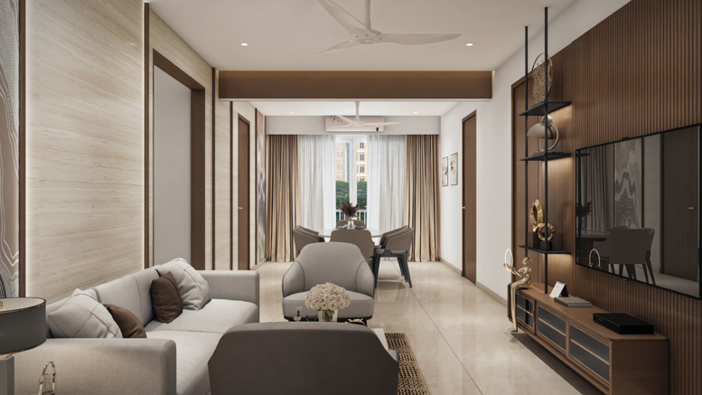 <br>`R14` `reference/living-room/p25-living-dining-hall-view.jpg` | geometry + composition |

**Model:** `seedream_5_5` - **Aspect:** 16:9 - **Resolution:** 4k

```text
Enhance this exact photograph of the apartment hall: living zone in front, dining under a walnut-clad bulkhead, window with white sheers and taupe drapes at the far end. Keep camera, layout, furniture and finishes: large-format travertine-look panels on the left wall, dark-walnut framed openings and doors, vertical fluted dark-walnut TV wall with wall-hung TV, black-metal floor-to-ceiling rod shelving with backlit shelves and brass objects, floating walnut console with smoked fluted-glass shutters, light-grey sofa with grey and brown cushions, grey tub armchair, jute flat-weave rug, white hydrangeas, two white ceiling fans, recessed downlights, light beige polished floor tiles. Soft daylight through the sheers, gentle bounce light, subtle tile reflections. Natural, unfiltered professional architectural photograph. Physically accurate light and soft natural shadows; true-to-life materials with real texture (genuine wood grain, real stone veining, woven fabric weave, crisp glass reflections); balanced exposure holding detail in highlights and shadows; neutral white balance; vertical lines kept vertical; subtle real-lens character; correct furniture scale.
```

**Must preserve:** hall proportion (long and narrow); TV wall, shelving and console design; sofa/armchair/rug positions; bulkhead, fans, downlights; panel joints and door positions.

Output -> `generated/living/LIV-01.png` -> web `public/images/sp-residency/living/sp-living-main.webp`

### LIV-02 - Living - secondary three-quarter view  `READY` `risk: medium`

| Reference | Role |
|---|---|
|  <br>`R14` `reference/living-room/p25-living-dining-hall-view.jpg` | design + materials |

**Model:** `nano_banana_pro` - **Aspect:** 4:5 - **Resolution:** 4k

```text
Three-quarter photograph of the same living room, camera at seated eye level near the left wall looking diagonally across to the fluted dark-walnut TV wall, the black-metal rod shelving with backlit shelves and brass objects, the floating walnut console with smoked fluted glass, the light-grey sofa and grey tub armchair in the foreground, and the dining zone and curtained window beyond. Only surfaces visible in the reference; identical materials and furniture. Soft daylight. Natural, unfiltered professional architectural photograph. Physically accurate light and soft natural shadows; true-to-life materials with real texture (genuine wood grain, real stone veining, woven fabric weave, crisp glass reflections); balanced exposure holding detail in highlights and shadows; neutral white balance; vertical lines kept vertical; subtle real-lens character; correct furniture scale.
```

**Must preserve:** TV-wall composition (TV, shelving left, console below); furniture design and colours.

**Note:** New camera inside the same room; restricted to surfaces shown in R14.

Output -> `generated/living/LIV-02.png` -> web `public/images/sp-residency/living/sp-living-secondary.webp`

### LIV-03 - Living - material detail  `READY` `risk: low`

| Reference | Role |
|---|---|
|  <br>`R14` `reference/living-room/p25-living-dining-hall-view.jpg` | material source |

**Model:** `nano_banana_pro` - **Aspect:** 4:5 - **Resolution:** 4k

```text
Close-up architectural detail photograph from the same living room: vertical fluted dark-walnut panelling with real grain, the black-metal rod shelf with a warm LED-lit shelf and a brushed-brass sculptural object, and the corner of the walnut console with smoked fluted-glass shutter below. Shallow depth of field, soft side light raking across the flutes. Natural, unfiltered professional architectural photograph. Physically accurate light and soft natural shadows; true-to-life materials with real texture (genuine wood grain, real stone veining, woven fabric weave, crisp glass reflections); balanced exposure holding detail in highlights and shadows; neutral white balance; vertical lines kept vertical; subtle real-lens character; correct furniture scale.
```

**Must preserve:** flute width and orientation; walnut tone; black metal + brass combination.

Output -> `generated/living/LIV-03.png` -> web `public/images/sp-residency/living/sp-living-detail.webp`

### DIN-01 - Dining - main view toward the window  `READY` `risk: medium`

| Reference | Role |
|---|---|
| 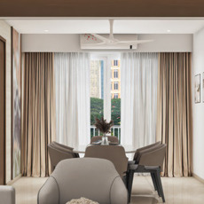 <br>`R15` `reference/dining/p25-dining-zone-crop.jpg` | dining zone (low-res crop) |
|  <br>`R14` `reference/living-room/p25-living-dining-hall-view.jpg` | context and materials |

**Model:** `nano_banana_pro` - **Aspect:** 4:5 - **Resolution:** 4k

```text
Photograph of the dining zone at the window end of the same apartment hall: oval glass-top dining table with taupe upholstered shell chairs on dark legs, dried-flower centrepiece, walnut-clad bulkhead above, full-height window with white sheers and taupe drapes opening to a balcony with white vertical balusters, split AC and white ceiling fan, light beige polished floor tiles, white walls with small framed art. Soft daylight through the sheers. Natural, unfiltered professional architectural photograph. Physically accurate light and soft natural shadows; true-to-life materials with real texture (genuine wood grain, real stone veining, woven fabric weave, crisp glass reflections); balanced exposure holding detail in highlights and shadows; neutral white balance; vertical lines kept vertical; subtle real-lens character; correct furniture scale.
```

**Must preserve:** chair and table type/colour; window, drapes, AC and bulkhead arrangement.

**Note:** Only source is a 230 px crop; table base and chair details will be partly inferred - review closely.

Output -> `generated/dining/DIN-01.png` -> web `public/images/sp-residency/dining/sp-dining-main.webp`

### DIN-02 - Dining - secondary / detail  `BLOCKED` `risk: blocked`

**Note:** BLOCKED. Only one distant dining view exists; any other angle or close-up would invent the dining furniture design.

### BED-01 - Master bedroom - main wide view (enhanced)  `READY` `risk: low`

| Reference | Role |
|---|---|
| 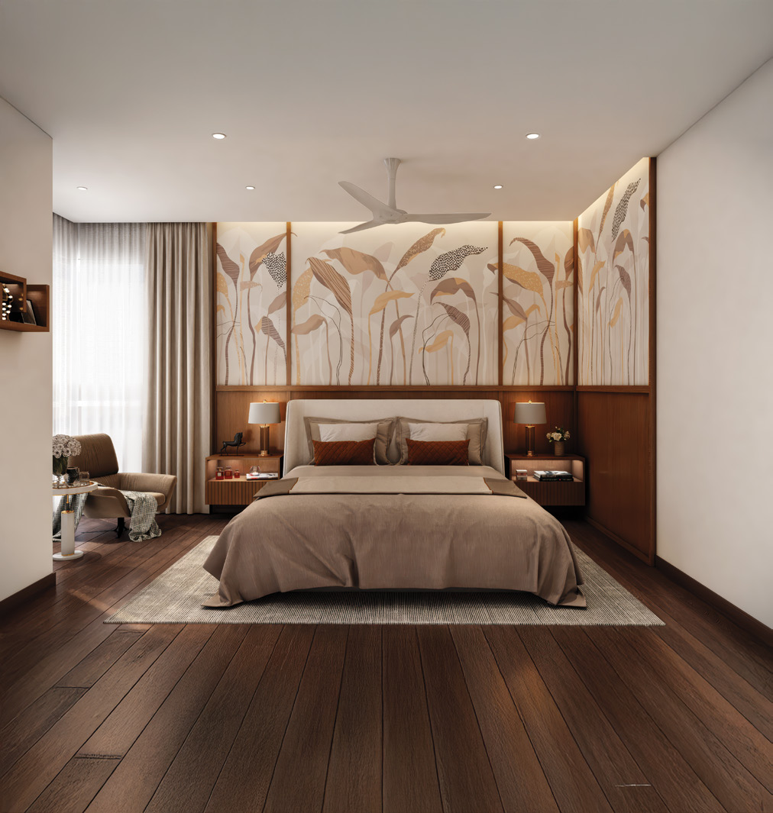 <br>`R16` `reference/master-bedroom/p24-bedroom-tropical-leaf-feature-wall.jpg` | geometry + composition |

**Model:** `seedream_5_5` - **Aspect:** 1:1 - **Resolution:** 4k

```text
Enhance this exact bedroom photograph: bed wall wrapping the right-hand corner with dark-walnut panelling to dado height and four walnut-framed panels of an illustrated tropical-leaf mural (beige, ochre and brown leaves, one leopard-spotted) with concealed cove light; cream upholstered headboard, taupe bedding, rust cushions; walnut bedside units with brass-base lamps and white shades; dark wide-plank walnut-look floor; grey-ivory textured rug; tan lounge chair with throw by the window; walnut box niches on the left wall; white sheers and taupe drapes; white ceiling fan; recessed downlights. Same camera and layout. Soft window daylight from the left, warm lamp and cove light. Natural, unfiltered professional architectural photograph. Physically accurate light and soft natural shadows; true-to-life materials with real texture (genuine wood grain, real stone veining, woven fabric weave, crisp glass reflections); balanced exposure holding detail in highlights and shadows; neutral white balance; vertical lines kept vertical; subtle real-lens character; correct furniture scale.
```

**Must preserve:** mural panel count, framing and leaf design; panelling height; bed, bedside, lamp design; floor plank direction; chair, niches, fan, downlights.

Output -> `generated/bedrooms/BED-01.png` -> web `public/images/sp-residency/bedrooms/sp-master-bedroom-main.webp`

### BED-02 - Master bedroom - secondary three-quarter view  `READY` `risk: medium`

| Reference | Role |
|---|---|
|  <br>`R16` `reference/master-bedroom/p24-bedroom-tropical-leaf-feature-wall.jpg` | design + materials |

**Model:** `nano_banana_pro` - **Aspect:** 4:5 - **Resolution:** 4k

```text
Three-quarter photograph of the same bedroom from beside the window and lounge chair, looking diagonally toward the bed wall and its wrap-around corner: walnut dado panelling, framed tropical-leaf mural panels with cove light, cream headboard, taupe bedding with rust cushions, walnut bedside unit and brass lamp, dark plank floor and textured rug. Only surfaces visible in the reference. Soft daylight from behind the camera. Natural, unfiltered professional architectural photograph. Physically accurate light and soft natural shadows; true-to-life materials with real texture (genuine wood grain, real stone veining, woven fabric weave, crisp glass reflections); balanced exposure holding detail in highlights and shadows; neutral white balance; vertical lines kept vertical; subtle real-lens character; correct furniture scale.
```

**Must preserve:** mural design and framing; corner wrap of the panelling; bed and bedside design.

Output -> `generated/bedrooms/BED-02.png` -> web `public/images/sp-residency/bedrooms/sp-master-bedroom-secondary.webp`

### BED-03 - Master bedroom - material detail  `READY` `risk: low`

| Reference | Role |
|---|---|
|  <br>`R16` `reference/master-bedroom/p24-bedroom-tropical-leaf-feature-wall.jpg` | material source |

**Model:** `nano_banana_pro` - **Aspect:** 4:5 - **Resolution:** 4k

```text
Close-up detail photograph from the same bedroom: one framed tropical-leaf mural panel meeting the dark-walnut dado panelling, the walnut bedside unit with its brass-base lamp lit, and the edge of the cream upholstered headboard. Cove light grazing the mural, real walnut grain, fabric texture. Natural, unfiltered professional architectural photograph. Physically accurate light and soft natural shadows; true-to-life materials with real texture (genuine wood grain, real stone veining, woven fabric weave, crisp glass reflections); balanced exposure holding detail in highlights and shadows; neutral white balance; vertical lines kept vertical; subtle real-lens character; correct furniture scale.
```

**Must preserve:** mural leaf style and palette; walnut tone; lamp design.

Output -> `generated/bedrooms/BED-03.png` -> web `public/images/sp-residency/bedrooms/sp-master-bedroom-detail.webp`

### BAL-01 - Balcony - main view (enhanced)  `READY` `risk: low`

| Reference | Role |
|---|---|
| 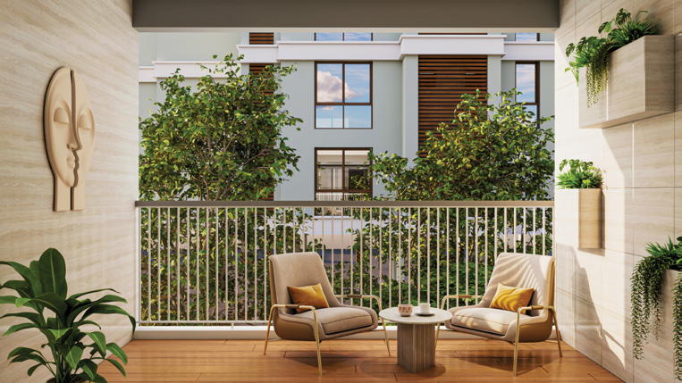 <br>`R17` `reference/balcony/p24-balcony-sit-out.jpg` | geometry + composition |

**Model:** `seedream_5_5` - **Aspect:** 16:9 - **Resolution:** 4k

```text
Enhance this exact balcony photograph: honey-toned wood-look floor tiles, travertine-look wall cladding both sides, sculptural face-mask wall art, wall-mounted wood-tone planter boxes with trailing greens, two beige upholstered lounge chairs on slim brass frames with mustard cushions, round fluted pedestal side table with two cups, white vertical-baluster handrail with a flat top rail, charcoal soffit, neighbouring building and trees beyond. Same camera. Soft morning daylight. Natural, unfiltered professional architectural photograph. Physically accurate light and soft natural shadows; true-to-life materials with real texture (genuine wood grain, real stone veining, woven fabric weave, crisp glass reflections); balanced exposure holding detail in highlights and shadows; neutral white balance; vertical lines kept vertical; subtle real-lens character; correct furniture scale.
```

**Must preserve:** chair, table and planter design/positions; baluster spacing; wall art; view beyond.

Output -> `generated/balcony/BAL-01.png` -> web `public/images/sp-residency/balcony/sp-balcony-main.webp`

### BAL-02 - Balcony - secondary view along the sit-out  `READY` `risk: medium`

| Reference | Role |
|---|---|
|  <br>`R17` `reference/balcony/p24-balcony-sit-out.jpg` | design + materials |

**Model:** `nano_banana_pro` - **Aspect:** 4:5 - **Resolution:** 4k

```text
Photograph along the same balcony from beside the face-mask wall art, looking toward the two lounge chairs, fluted side table, the planter-box wall and the white baluster handrail with trees beyond. Only elements visible in the reference. Morning daylight. Natural, unfiltered professional architectural photograph. Physically accurate light and soft natural shadows; true-to-life materials with real texture (genuine wood grain, real stone veining, woven fabric weave, crisp glass reflections); balanced exposure holding detail in highlights and shadows; neutral white balance; vertical lines kept vertical; subtle real-lens character; correct furniture scale.
```

**Must preserve:** furniture design; planter wall; handrail design.

Output -> `generated/balcony/BAL-02.png` -> web `public/images/sp-residency/balcony/sp-balcony-secondary.webp`

### BAL-03 - Balcony - material detail  `READY` `risk: low`

| Reference | Role |
|---|---|
|  <br>`R17` `reference/balcony/p24-balcony-sit-out.jpg` | material source |

**Model:** `nano_banana_pro` - **Aspect:** 4:5 - **Resolution:** 4k

```text
Close-up of the balcony lounge chair: beige upholstery with a mustard cushion on a slim brass frame, the fluted pedestal side table with two cups, and the honey wood-look floor tile. Soft daylight, shallow depth of field. Natural, unfiltered professional architectural photograph. Physically accurate light and soft natural shadows; true-to-life materials with real texture (genuine wood grain, real stone veining, woven fabric weave, crisp glass reflections); balanced exposure holding detail in highlights and shadows; neutral white balance; vertical lines kept vertical; subtle real-lens character; correct furniture scale.
```

**Must preserve:** chair frame and colours; table fluting.

Output -> `generated/balcony/BAL-03.png` -> web `public/images/sp-residency/balcony/sp-balcony-detail.webp`

### COR-01 - Corridor - main view (enhanced)  `READY` `risk: low`

| Reference | Role |
|---|---|
| 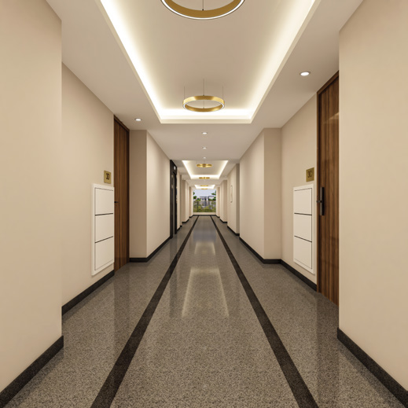 <br>`R25` `reference/amenities/p24-typical-floor-corridor.jpg` | geometry + composition |

**Model:** `seedream_5_5` - **Aspect:** 1:1 - **Resolution:** 4k

```text
Enhance this exact one-point-perspective photograph of the residential corridor: grey speckled granite floor with two black-granite inlay bands, black skirting, cream walls, dark-walnut doors with brass number plates, white wall-mounted cabinets beside the doors, raised false-ceiling tray with perimeter cove light, brass ring pendants and downlights, window to greenery at the end. Same camera. Real granite speckle and polish, warm 3000K cove light balanced with daylight from the end window. Natural, unfiltered professional architectural photograph. Physically accurate light and soft natural shadows; true-to-life materials with real texture (genuine wood grain, real stone veining, woven fabric weave, crisp glass reflections); balanced exposure holding detail in highlights and shadows; neutral white balance; vertical lines kept vertical; subtle real-lens character; correct furniture scale.
```

**Must preserve:** corridor length and vanishing point; door and cabinet rhythm; pendant count; inlay band positions.

Output -> `generated/amenities/COR-01.png` -> web `public/images/sp-residency/amenities/sp-corridor-main.webp`

### COR-02 - Corridor - landscape web format  `READY` `risk: medium`

| Reference | Role |
|---|---|
|  <br>`R25` `reference/amenities/p24-typical-floor-corridor.jpg` | geometry + composition |

**Model:** `flux_2_pro_outpaint` - **Aspect:** 16:9 - **Resolution:** source

```text
Extend the corridor photograph left and right only with the same cream walls, black skirting, granite floor and ceiling tray. No new doors, fixtures or objects.
```

**Must preserve:** original pixels unchanged.

**Note:** Outpaint side walls to 16:9 for web banners (expand_left/expand_right ~ 200 px each).

Output -> `generated/amenities/COR-02.png` -> web `public/images/sp-residency/amenities/sp-corridor-wide.webp`

### COR-03 - Corridor - material detail  `READY` `risk: low`

| Reference | Role |
|---|---|
|  <br>`R25` `reference/amenities/p24-typical-floor-corridor.jpg` | material source |

**Model:** `nano_banana_pro` - **Aspect:** 4:5 - **Resolution:** 4k

```text
Upward detail photograph of the same corridor ceiling: brass ring pendant hanging in the raised false-ceiling tray with warm perimeter cove light and a downlight; and a matching floor detail of the grey speckled granite meeting the black-granite inlay band and black skirting. Natural, unfiltered professional architectural photograph. Physically accurate light and soft natural shadows; true-to-life materials with real texture (genuine wood grain, real stone veining, woven fabric weave, crisp glass reflections); balanced exposure holding detail in highlights and shadows; neutral white balance; vertical lines kept vertical; subtle real-lens character; correct furniture scale.
```

**Must preserve:** ring pendant design; cove detail; granite colours.

Output -> `generated/amenities/COR-03.png` -> web `public/images/sp-residency/amenities/sp-corridor-detail.webp`

### AME-01 - Management office (enhanced)  `READY` `risk: low`

| Reference | Role |
|---|---|
| 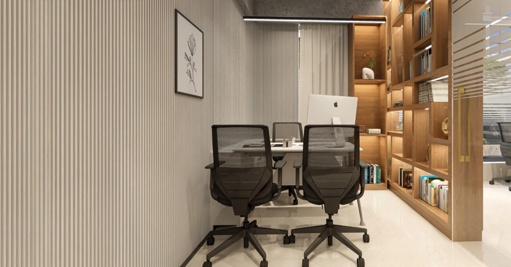 <br>`R20` `reference/amenities/p11-management-office.jpg` | geometry + composition |

**Model:** `seedream_5_5` - **Aspect:** 16:9 - **Resolution:** 4k

```text
Enhance this exact photograph of the management office: light-grey fluted wall panel with a framed botanical sketch, white desk with all-in-one computer, two black mesh task chairs, full-height walnut bookshelf with backlit shelves, striped frosted glass partition, timber door with long brass pull, white large-format floor tiles. Same camera and layout. Soft daylight. Natural, unfiltered professional architectural photograph. Physically accurate light and soft natural shadows; true-to-life materials with real texture (genuine wood grain, real stone veining, woven fabric weave, crisp glass reflections); balanced exposure holding detail in highlights and shadows; neutral white balance; vertical lines kept vertical; subtle real-lens character; correct furniture scale.
```

**Must preserve:** furniture positions; bookshelf design; partition and door.

Output -> `generated/amenities/AME-01.png` -> web `public/images/sp-residency/amenities/sp-management-office.webp`

### AME-02 - Co-working / study room (enhanced)  `READY` `risk: low`

| Reference | Role |
|---|---|
| 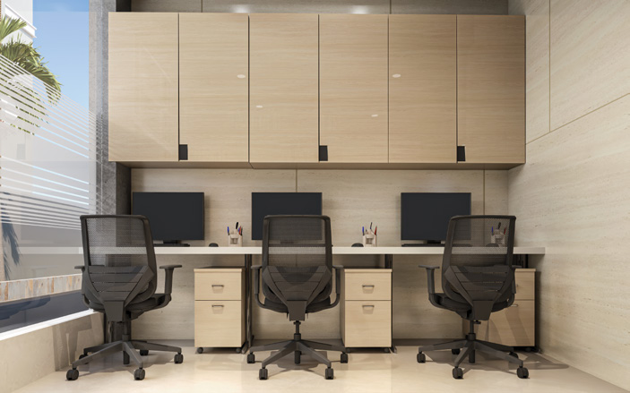 <br>`R21` `reference/amenities/p11-coworking-study-room.jpg` | geometry + composition |

**Model:** `seedream_5_5` - **Aspect:** 16:9 - **Resolution:** 4k

```text
Enhance this exact photograph of the co-working room: three workstations on a white worktop, light-oak overhead cabinets and pedestal drawers, black mesh chairs, monitors, travertine-look wall tiles, striped frosted glazing, window at left. Same camera and layout. Soft daylight. Natural, unfiltered professional architectural photograph. Physically accurate light and soft natural shadows; true-to-life materials with real texture (genuine wood grain, real stone veining, woven fabric weave, crisp glass reflections); balanced exposure holding detail in highlights and shadows; neutral white balance; vertical lines kept vertical; subtle real-lens character; correct furniture scale.
```

**Must preserve:** three-station layout; cabinet module count; glazing film.

Output -> `generated/amenities/AME-02.png` -> web `public/images/sp-residency/amenities/sp-coworking.webp`

### AME-03 - Gym - cardio zone (enhanced)  `READY` `risk: low`

| Reference | Role |
|---|---|
| 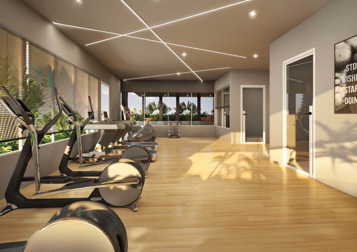 <br>`R22` `reference/amenities/p12-gym-cardio-zone.jpg` | geometry + composition |

**Model:** `seedream_5_5` - **Aspect:** 16:9 - **Resolution:** 4k

```text
Enhance this exact gym photograph: light wood-look floor, grey walls, crossing linear LED strips and recessed spots on the ceiling, ellipticals and treadmills along a glazed wall with horizontal blinds and planting outside, glass door. Same camera and equipment. Warm afternoon sun through the blinds casting real slatted shadows. Natural, unfiltered professional architectural photograph. Physically accurate light and soft natural shadows; true-to-life materials with real texture (genuine wood grain, real stone veining, woven fabric weave, crisp glass reflections); balanced exposure holding detail in highlights and shadows; neutral white balance; vertical lines kept vertical; subtle real-lens character; correct furniture scale.
```

**Must preserve:** equipment count and positions; ceiling LED pattern; door and glazing.

Output -> `generated/amenities/AME-03.png` -> web `public/images/sp-residency/amenities/sp-gym-cardio.webp`

### AME-04 - Gym - strength zone (enhanced)  `READY` `risk: low`

| Reference | Role |
|---|---|
| 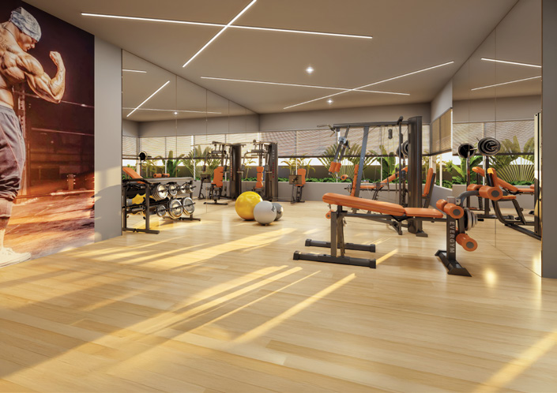 <br>`R23` `reference/amenities/p12-gym-strength-zone.jpg` | geometry + composition |

**Model:** `seedream_5_5` - **Aspect:** 16:9 - **Resolution:** 4k

```text
Enhance this exact gym photograph: large bodybuilder wall mural, multi-station machine, benches with orange upholstery, dumbbell rack, yellow and grey Swiss balls, wood-look floor, crossing LED ceiling strips, glazing with planting. Same camera and equipment. Warm afternoon sun. Natural, unfiltered professional architectural photograph. Physically accurate light and soft natural shadows; true-to-life materials with real texture (genuine wood grain, real stone veining, woven fabric weave, crisp glass reflections); balanced exposure holding detail in highlights and shadows; neutral white balance; vertical lines kept vertical; subtle real-lens character; correct furniture scale.
```

**Must preserve:** mural; equipment layout; ceiling pattern.

Output -> `generated/amenities/AME-04.png` -> web `public/images/sp-residency/amenities/sp-gym-strength.webp`

### AME-05 - Rooftop lounge (enhanced)  `READY` `risk: low`

| Reference | Role |
|---|---|
| 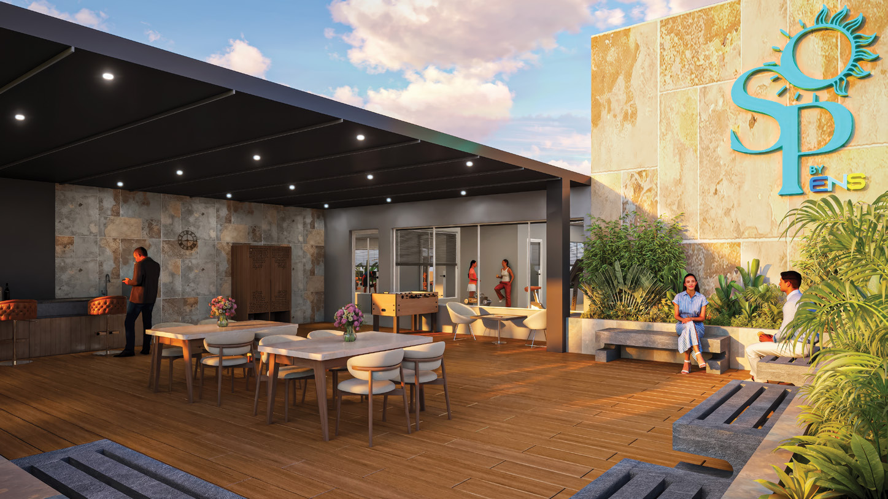 <br>`R24` `reference/amenities/p12-rooftop-lounge.jpg` | geometry + composition |

**Model:** `seedream_5_5` - **Aspect:** 16:9 - **Resolution:** 4k

```text
Enhance this exact rooftop lounge photograph: covered timber deck under a dark soffit with downlights, slate/sandstone tile feature wall with clock, BBQ counter with tan leather bar stools, carved walnut cabinet, two dining tables with ivory shell chairs and flowers, foosball table, glazed gym beyond, stone wall with the existing logo, tropical planters, timber benches. Keep camera, furniture and the existing people unchanged. Golden-hour light, real deck grain. Natural, unfiltered professional architectural photograph. Physically accurate light and soft natural shadows; true-to-life materials with real texture (genuine wood grain, real stone veining, woven fabric weave, crisp glass reflections); balanced exposure holding detail in highlights and shadows; neutral white balance; vertical lines kept vertical; subtle real-lens character; correct furniture scale.
```

**Must preserve:** furniture and people positions; tile wall pattern; planters; logo wall as-is.

Output -> `generated/amenities/AME-05.png` -> web `public/images/sp-residency/amenities/sp-rooftop-lounge.webp`

### AME-06 - Rooftop lounge - material detail  `READY` `risk: low`

| Reference | Role |
|---|---|
|  <br>`R24` `reference/amenities/p12-rooftop-lounge.jpg` | material source |

**Model:** `nano_banana_pro` - **Aspect:** 4:5 - **Resolution:** 4k

```text
Close-up from the same rooftop lounge: the slate/sandstone tile feature wall behind the BBQ counter, tan leather bar stools, the timber deck underfoot. Golden-hour side light raking the stone. Natural, unfiltered professional architectural photograph. Physically accurate light and soft natural shadows; true-to-life materials with real texture (genuine wood grain, real stone veining, woven fabric weave, crisp glass reflections); balanced exposure holding detail in highlights and shadows; neutral white balance; vertical lines kept vertical; subtle real-lens character; correct furniture scale.
```

**Must preserve:** tile colours and pattern; stool design.

Output -> `generated/amenities/AME-06.png` -> web `public/images/sp-residency/amenities/sp-rooftop-detail.webp`

### AME-07 - Lobby - material detail  `READY` `risk: low`

| Reference | Role |
|---|---|
|  <br>`R18` `reference/amenities/p11-private-lobby.jpg` | material source |
|  <br>`R19` `reference/amenities/p25-lobby-library-lounge.jpg` | material source |

**Model:** `nano_banana_pro` - **Aspect:** 4:5 - **Resolution:** 4k

```text
Close-up detail from the lobby: woven rattan pendant in front of the horizontal-stripe frosted glass, travertine-look wall panel with shadow gap, and the walnut-to-white-tile floor transition with its slim LED edge. Soft daylight. Natural, unfiltered professional architectural photograph. Physically accurate light and soft natural shadows; true-to-life materials with real texture (genuine wood grain, real stone veining, woven fabric weave, crisp glass reflections); balanced exposure holding detail in highlights and shadows; neutral white balance; vertical lines kept vertical; subtle real-lens character; correct furniture scale.
```

**Must preserve:** pendant weave; stripe film spacing; panel joint.

Output -> `generated/lobby/AME-07.png` -> web `public/images/sp-residency/lobby/sp-lobby-detail.webp`

### KIT-00 - Kitchen  `BLOCKED` `risk: blocked`

| Reference | Role |
|---|---|
| 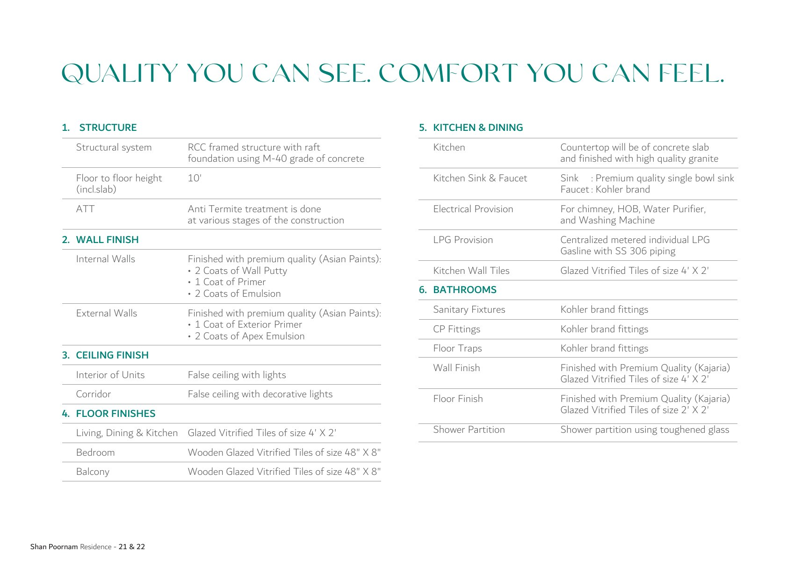 <br>`R32` `reference/specifications/p22-specifications-1.jpg` | specification only |
| 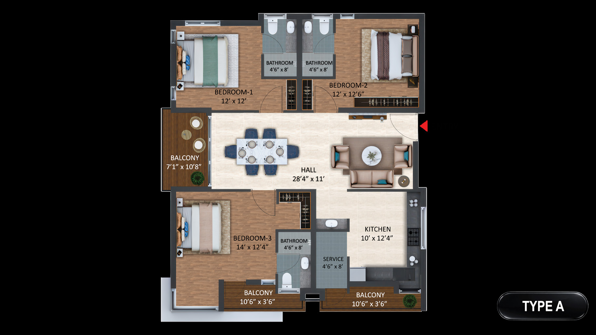 <br>`R08` `reference/floor-plans/p16-unit-type-a-3bhk.jpg` | plan only |

```text
DRAFT - DO NOT RUN WITHOUT A CLIENT DESIGN BRIEF. Kitchen of a Shan Poornam Residence 3BHK (10' x 12'4" incl. utility): L-shaped counter of concrete slab finished in granite, premium single-bowl sink with Kohler faucet, hob on the external wall with a window, 4' x 2' glazed vitrified wall tiles, 4' x 2' light beige floor tiles, door to a 4'6" x 8' service yard. Cabinet design, colours and appliances are NOT defined in the brochure.
```

**Note:** BLOCKED. No kitchen render in the brochure. The draft lists only specified facts; generating it would invent cabinetry and finishes.

### BTH-00 - Bathroom  `BLOCKED` `risk: blocked`

| Reference | Role |
|---|---|
|  <br>`R32` `reference/specifications/p22-specifications-1.jpg` | specification only |

```text
DRAFT - DO NOT RUN WITHOUT A CLIENT DESIGN BRIEF. 4'6" x 8' bathroom: Kohler wall-hung WC, basin and CP fittings, Kajaria 4' x 2' glazed vitrified wall tiles, 2' x 2' floor tiles, toughened-glass shower partition, geyser point. Tile colours, vanity and mirror design are NOT defined in the brochure.
```

**Note:** BLOCKED. No bathroom render in the brochure.

### POO-00 - Pooja room  `BLOCKED` `risk: blocked`

**Note:** BLOCKED. No pooja room, unit or niche appears anywhere in the brochure.

### BED-90 - Secondary bedrooms / wardrobes  `BLOCKED` `risk: blocked`

**Note:** BLOCKED. Only one bedroom design is shown; wardrobes appear only as plan symbols.

## Location

### LOC-00 - Location visualisation  `BLOCKED` `risk: blocked`

**Note:** No AI imagery: a generated neighbourhood would be fiction. The website renders the brochure's distance data as a typographic panel, and the original map (R28) is available as a reference.
